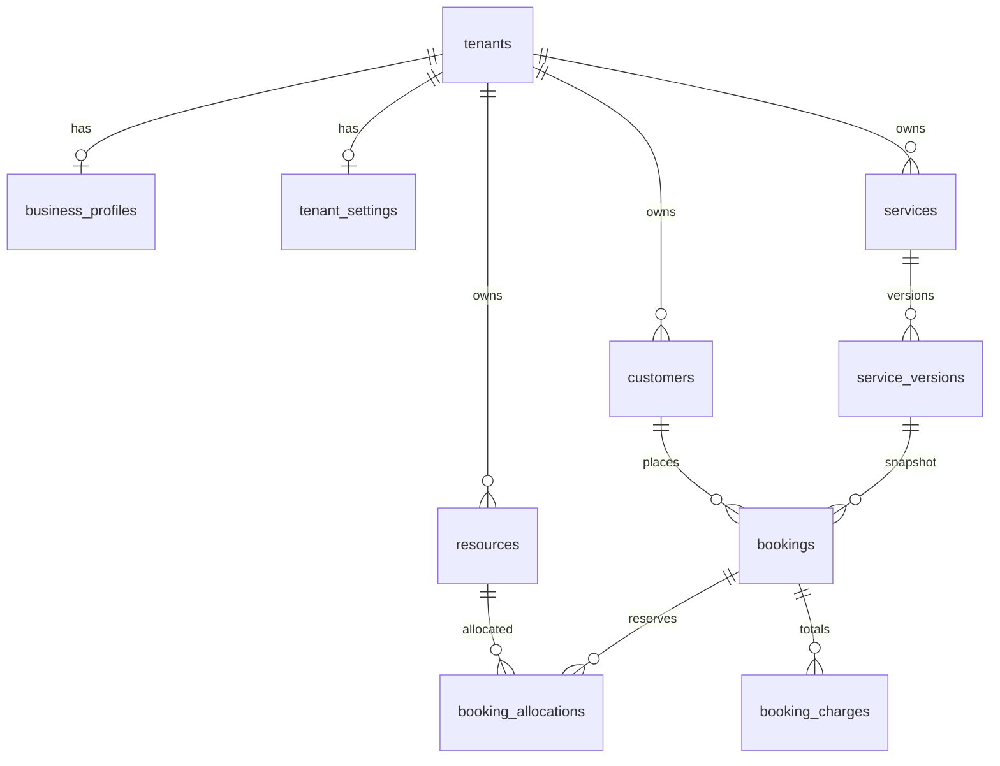

# Domain model

Drizzle schema lives under `packages/database/src/schema/`. Every tenant-owned table includes `tenant_id`.

## Context map

## Tenancy and identity

| Entity                  | Notes                                              |
| ----------------------- | -------------------------------------------------- |
| `tenants`               | Slug, status (`active` / `suspended` / `archived`) |
| `business_profiles`     | Display name, contact, address JSON                |
| `tenant_settings`       | Timezone, currency, locale, deployment flags       |
| `tenant_domains`        | Custom hostnames, verification tokens              |
| `users`                 | Global users (email login); platform admin flag    |
| `tenant_memberships`    | User ↔ tenant with role                            |
| `roles` / `permissions` | RBAC catalog                                       |
| `customers`             | Registered or guest profile per tenant             |
| `external_identities`   | Host-system subject mapping for token exchange     |
| `api_keys`              | Hashed secrets for server-to-server calls          |

## Catalog and configuration

| Entity                                                    | Notes                                                                                     |
| --------------------------------------------------------- | ----------------------------------------------------------------------------------------- |
| `categories`, `services`                                  | Published catalog; soft-delete aware                                                      |
| `service_versions`                                        | Immutable published config: `booking_definition`, links to form/workflow/pricing versions |
| `form_definitions`, `workflow_definitions`, `policy_sets` | Versioned JSON documents                                                                  |
| `pricing_rules`                                           | Attached to service versions                                                              |

## Resources and availability

| Entity                                       | Notes                                       |
| -------------------------------------------- | ------------------------------------------- |
| `resources`                                  | Exclusive units, pools, or capacity buckets |
| `resource_attributes`, `staff_profiles`      | Metadata and schedulable people             |
| `operating_schedules`, `schedule_exceptions` | Business hours and one-off closures         |
| `blackouts`, `maintenance_windows`           | Resource unavailability                     |

## Bookings and payments

| Entity                                                              | Notes                                                              |
| ------------------------------------------------------------------- | ------------------------------------------------------------------ |
| `bookings`                                                          | Reference, status, frozen pricing/policy snapshots, payment status |
| `booking_allocations`                                               | `tstzrange` periods; exclusive overlap constrained in DB           |
| `booking_participants`, `booking_answers`, `booking_status_history` | Guest forms and audit trail                                        |
| `booking_holds`                                                     | Short-lived inventory locks                                        |
| `idempotency_keys`                                                  | Dedup public creates                                               |
| `charges`, `payments`, `refunds`                                    | Money in NUMERIC/string decimal; server totals                     |

## Integrations and system

| Entity                                                             | Notes                            |
| ------------------------------------------------------------------ | -------------------------------- |
| `webhook_endpoints`, `webhook_subscriptions`, `webhook_deliveries` | Outbound events                  |
| `outbox_events`                                                    | Transactional outbox for workers |
| `audit_logs`                                                       | Append-only admin actions        |
| `files`                                                            | Uploaded assets metadata         |

## Key invariants

1. A booking always points at a **published `service_version_id`**; configuration changes do not alter past bookings.
2. **Pricing and policy snapshots** on the booking row are authoritative for disputes and refunds.
3. **Exclusive allocations** cannot overlap for the same `resource_id` while status is `held` or `active` (Postgres exclusion constraint).
4. Loads by primary key for tenant data must include **`tenant_id`** in the query (application + RLS).
