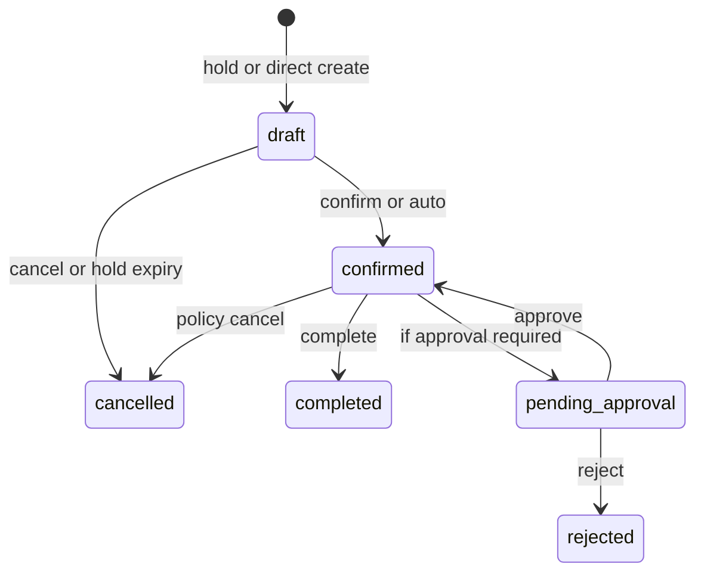

# Booking engines

Engine packages are **pure TypeScript**: no HTTP, ORM, or payment SDK imports. The API orchestrates them inside transactions.

## Booking strategies

Built-in types (`packages/core/src/booking-definition.ts`):

`appointment`, `accommodation`, `rental`, `capacity`, `event`, `table`, `custom`

Each strategy implements `BookingStrategy` in `packages/booking-engine`:

| Method                  | Purpose                                                  |
| ----------------------- | -------------------------------------------------------- |
| `validateConfiguration` | Parse and reject incompatible booking definitions        |
| `calculateDuration`     | Turn customer input into UTC window in business timezone |
| `calculateAvailability` | Searchable slots/ranges with inventory rules             |
| `validateReservation`   | Pre-create validation                                    |
| `buildAllocation`       | Planned rows for `booking_allocations`                   |

Custom server plugins can register via `StrategyRegistry.register()` at API bootstrap.

**Compatibility rules** (examples): date-range + slot time is invalid; exclusive/pooled inventory requires resources; guest-capacity matching requires guests enabled.

## Availability engine

`packages/availability-engine` combines:

- Operating schedules and exceptions
- Resource/staff calendars
- Blackouts and maintenance
- Strategy-specific slot generation (fixed, customer duration, date-based nights/days)
- Capacity and pooled inventory counts

Search returns structured ranges the portal and quote endpoints consume.

## Resource engine

`packages/resource-engine` selects concrete resources from a pool (`selectResources`) and builds allocation plans (`buildAllocations`) with exclusive flags and blocked periods (buffers).

## Pricing engine

`packages/pricing-engine` runs a **fixed calculation order** on the server:

1. Base / unit lines from strategy and quantity
2. Modifiers and options
3. Discounts and promo codes
4. Fees
5. Taxes
6. Deposits and refundable deposits

Clients may display estimates; **create booking** always persists `pricing_snapshot` from a fresh server quote.

## Workflow engine

`packages/workflow-engine` defines:

- **Status categories** — whether a status holds inventory (`held`, `active`, terminal, etc.)
- **Transitions** — allowed actions per status (confirm, cancel, reschedule, approve, …)

Bookings store current `status`, `status_category`, and `workflow_step`. Admin and API transitions validate against the workflow definition frozen via `service_version`.

## Lifecycle (simplified)

Exact states depend on the service workflow JSON. Holds expire via `hold.cleanup` worker unless converted to a booking.

## Policy and reschedule

`packages/booking-engine` policy snapshots capture cancellation/reschedule rules at booking time. `apps/api/src/modules/bookings/reschedule.ts` enforces policy windows and re-runs availability + pricing before moving allocations.
