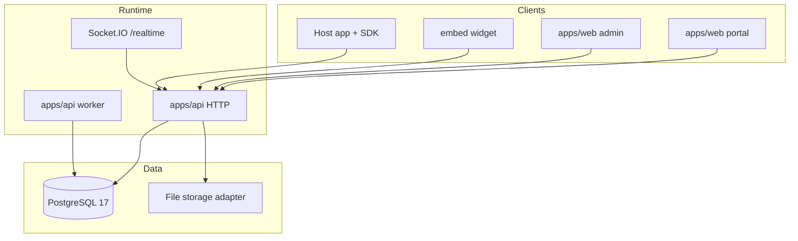

# System architecture

Universal Booking is a **modular monolith**: one deployable API and worker process family, with pure engine packages that have no Express/React dependencies.

## Applications

| App        | Stack                                 | Role                                                                                                 |
| ---------- | ------------------------------------- | ---------------------------------------------------------------------------------------------------- |
| `apps/api` | Express 5, Drizzle, pg-boss or BullMQ | REST `/api/v1`, identity, tenant middleware, route modules, background jobs                          |
| `apps/web` | Next.js 15, React 19                  | Public catalog and booking at `/[businessSlug]`, admin at `/admin`, embed at `/embed/[businessSlug]` |

## Engine packages

| Package                           | Responsibility                                             |
| --------------------------------- | ---------------------------------------------------------- |
| `packages/core`                   | Shared types, money, errors, booking definition schema     |
| `packages/booking-engine`         | Strategy registry and reservation planning                 |
| `packages/availability-engine`    | Slots, ranges, operating hours, search                     |
| `packages/resource-engine`        | Resource selection and allocation rows                     |
| `packages/pricing-engine`         | Quote calculation order (server-only)                      |
| `packages/workflow-engine`        | Status categories, transitions, lifecycle                  |
| `packages/database`               | Schema, migrations, `tenant()` / `system()` clients, seeds |
| `packages/contracts`              | Zod inputs/outputs → OpenAPI                               |
| `packages/auth`                   | Password hashing, CSRF, JWT helpers                        |
| `packages/payment-providers`      | PayMongo, Xendit, Stripe, manual/cash adapters             |
| `packages/notification-providers` | Email/SMS console or provider drivers                      |
| `packages/webhooks`               | Signing, delivery, SSRF checks                             |

## Background work

The worker (`npm run worker -w @universal-booking/api`) runs when `JOBS_ENABLED=true`:

- `hold.cleanup` — release expired holds
- `outbox.fanout` — domain events → webhook/notification queues
- `webhooks.deliver` — HTTP delivery with retries
- `notifications.deliver` / `notifications.reminders`
- `payments.recheck` — reconcile pending provider payments

Uses **pg-boss** on `DATABASE_URL` by default; set `REDIS_URL` to use BullMQ for the same job names.

## Typical request flow (admin booking)

1. Express middleware resolves `requestId`, parses cookies, applies rate limits.
2. Identity middleware loads JWT / API key → `req.ctx` principal.
3. Tenant middleware resolves tenant from header, slug, or host (where configured).
4. Route handler validates body with Zod (`packages/contracts`).
5. Handler calls `app.db.tenant(tenantId, tx => …)`; Postgres session sets `app.tenant_id` and optionally `SET LOCAL ROLE booking_app`.
6. Engines compute availability, price, allocations; booking row + outbox event commit in one transaction.
7. Worker delivers webhooks asynchronously from the outbox.

Public portal routes use `tenant: 'public'` and `:businessSlug` resolution without a staff session. Booking creates accept `Idempotency-Key`.

See also: [DOMAIN.md](DOMAIN.md), [DATA_ISOLATION.md](DATA_ISOLATION.md), [ENGINES.md](ENGINES.md), [DEPLOYMENT.md](DEPLOYMENT.md).
